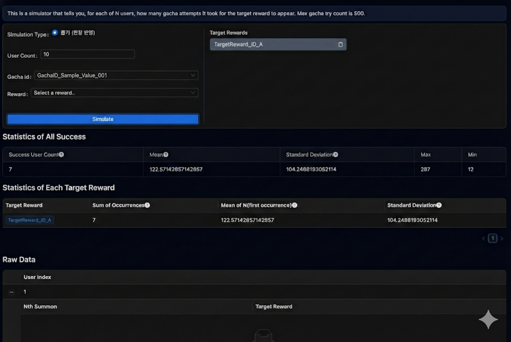

## Intro

I'm a developer on a game development team. I want to share a story about a critical issue I faced and the systems I built to fix it. The story is about random item systems, which are directly tied to user trust.

## The Incident: A Crack in Trust

The game I'm working on has a "gacha" system. Users spend in-game currency to get random items. Two things matter most in such a system. We must openly show the probabilities to the user. We must also give out items exactly according to those probabilities. Users set their expectations based on the rate table we provide. This becomes a measure of their trust in the service.

The incident happened without warning. A user reported:

> "I got an item from the gacha that wasn't even on the rate table."

At first, I couldn't believe it. It's a huge problem if an item on the rate table fails to appear. The opposite case is when an item _not_ on the list appears. That is a critical bug that damages the basic credibility of the system. Suppose that item had been advertised as "only obtainable through real-money purchases." Users who had already bought that package would have felt extremely betrayed.

## Root Cause Analysis: An Unexpected Detour

I saw how serious the problem was, so I immediately began to look for the cause. Naturally, I first suspected a mismatch between two pieces of logic. One "displays the rate table" and the other "actually draws the item."

Of course, the logic for `showRatesTable` and `drawGacha` must share the same data and functions. The entire process should use a common flow that branches only at the **final step**. That step should either "display the table to the user" or "draw an item based on those rates."

I built my system strictly on this principle, so I was confident that its logic was consistent. So, where did the problem come from? I checked the user's logs and confirmed that their report was true. The system had indeed given out an unintended item. I formed several hypotheses and traced the code.

1. **An Item Substitution System?** Our game has a system for duplicate items. If the user already owns an item, the system replaces the duplicate with something else. However, this case would have left a clear log, such as "Item A was drawn, replaced with Item B." This wasn't the cause.
2. **The Hidden Detour: The "Pity System"**: This was the root of the problem. My gacha system included a so-called **"pity system"**. It guaranteed a better reward for users who made a certain number of draws. Normally, the gacha uses a standard item list called `pool1`. But users who hit the pity counter would get a reward from a better list called `pool2`.

The problem was that `pool2` contained an item that was not in `pool1`. The pity system is **dynamic** and depends on a user's total draw count. Because of this, the **static** rate table did not fully show its possible results. From the user's point of view, an unexpected item that wasn't on the rate table had simply appeared from nowhere.

## Test Random Systems

This incident made me think deeply about how to test systems that include random elements. Randomness is **non-deterministic** by nature. This makes it very hard to write automated tests for.

For example, consider the following code:

```scala
// A function to draw a random item
def drawGachaItem(): Item = {
  val items = List(Item("Sword"), Item("Shield"), Item("Potion"))
  val index = scala.util.Random.nextInt(items.length)
  items(index)
}

// This test is likely to fail because the result changes on each run.
val result = drawGachaItem()
assert(result.name == "Sword")
```

The classic solution is to fix the random seed, which makes the test environment deterministic.

```scala
def drawGachaItemWithSeed(random: Random): Item = {
  val items = List(Item("Sword"), Item("Shield"), Item("Potion"))
  val index = random.nextInt(items.length)
  items(index)
}

// Using a fixed seed ensures the same result every time.
val fakeRandom = new Random(0)
val result = drawGachaItemWithSeed(fakeRandom)
assert(result.name == "Potion") // Now, this test will consistently pass or fail.
```

However, my problem was the item pool mismatch caused by the pity system. I couldn't solve it simply by fixing a random seed. The goal wasn't to predict a single outcome. The goal was to do an **exhaustive check of all possible item types** that could be awarded.

## My Approaches

After much thought, I implemented two powerful solutions to build a verification system with multiple layers.

### Approach 1: Preemptive Blocking via Static Data Analysis

The first solution is a static analysis step. It validates all gacha item pools during the game data build process. The logic is as follows:

1. Take the base item pool (`pool1`) for a gacha, and flatten it into a set of all possible items.
2. Take the item pools for special conditions like the pity system (`pool2`), and flatten them into sets as well.
3. **Check if `pool2` is a subset of `pool1`**.
4. If `pool2` contains even a single item that is not in `pool1`, fail the data build and throw an error.

```scala
// This is pseudocode to explain the logic, not literal production code.
def validateGachaPools(gachaGroup: GachaGroup): Result[Unit] = {
  // 1. Get the set of items from the base pool (pool1) used for the rate table.
  val basePoolItems: Set[ItemId] = getBasePoolItems(gachaGroup.basePoolId)

  // 2. Get all item sets from special pools (pool2, pool3...).
  val specialPoolItemIds: List[PoolId] = gachaGroup.specialPoolIds
  val specialPoolItems: List[Set[ItemId]] = specialPoolItemIds.map(getSpecialPoolItems)

  // 3. Check if every special pool is a subset of the base pool.
  specialPoolItems.foreach { specialItems =>
    val unexpectedItems = specialItems -- basePoolItems
    if (unexpectedItems.nonEmpty) {
      // 4. If not, fail the build, specifying which items are problematic.
      return Failure(s"GachaGroup ${gachaGroup.id}: Special pool contains items not in base pool: $unexpectedItems")
    }
  }
  Success(())
}
```

With this validation logic, I could stop any item not on the rate table from entering the system at all. This approach completely solved the original problem. It gave a 100% guarantee: an item not on the rate table could never appear, even from a special pool.

#### The Limitations of Static Analysis

However, I soon realized that this static check had its own limitations, even though it was crucial for data integrity. It could answer "_what_ can appear," but it couldn't answer several other critical questions:

- **Are the probabilities correct?** The analyzer confirms that all items in `pool2` also exist in `pool1`. But it doesn't check if their drop rates match the intended design. An item's probability could be 0.1% in the main pool but set to 10% by accident in the pity pool.
- **How does dynamic, user-specific logic behave?** The check cannot cover logic that depends on a player's state. One example is the "item substitution" feature for users who already own a specific item. The final reward can change based on each user's own inventory.
- **What is the actual user experience?** The check tells you nothing about the player's journey. It can't tell you the average cost to get a target item. It also can't tell you if the overall experience _feels_ fair and rewarding.

To fill these gaps, I needed a way to watch the system as it runs. This led me to my second approach.

### Approach 2: Dynamic Verification Using a Simulator

Static analysis might miss some complex cases. To catch them and to predict the actual user experience, we can think of a "simulator." A simulator has huge advantages:

- **Statistical Verification**: It runs tens of thousands of virtual draws and gives a statistical analysis of the results. The effect is close to an exhaustive check.
- **Visualization and Communication**: The simulator can give a report like, "After 5,000 draws, these items appeared with this frequency." Colleagues who are not developers can easily understand it. This makes it easier to review together whether the design intent was met.
- **Complex State Replication**: It can simulate complex logic where draw results depend on a user's state (level, inventory, progress). This gives much broader test coverage for various users.
- **User Experience Prediction**: It does more than find bugs. It also helps predict UX metrics in numbers, like, "What is the average number of draws required to get a specific item?" This data is extremely useful for balance tuning.

#### The N-Repetition Simulator


This is the most basic simulator. It runs a specific gacha `N` times and returns a list and count of all acquired items.

```scala
// Abstracted code for the N-repetition simulator logic
def runSimpleSimulation(gachaId: GachaId, count: Int): SimulationResult = {
  val singleTry = program.runGachaOnce(gachaId) // The logic for a single draw
  val results = singleTry.replicate(count)      // Replicate it N times
  return aggregateAndAnalyze(results)           // Aggregate and analyze the results
}
```

#### The Target Reward Acquisition Simulator



Next, I went a step further and decided to simulate the "end-to-end user journey." This tool creates `N` virtual users. It measures how many draws each user needs to get a set of specified target items.

```scala
// Abstracted code for the target acquisition simulator logic
def runTargetSimulation(gachaId: GachaId, targetItems: Set[ItemId], userCount: Int): TargetSimulationResult = {
  // Run simulations in parallel for N virtual users
  val results = parallel_for_each(1 to userCount) { user_id =>
    // Each user keeps drawing until all target items are acquired
    simulateUntilTargetAcquired(gachaId, targetItems)
  }
  return aggregateAndAnalyze(results) // Aggregate results, like draws-per-user
}
```

#### Limitations of the Simulator Approach

However, the simulator does not solve everything, and it has its own set of trade-offs:

- **It's Statistical, Not Exhaustive:** A simulation gives strong statistical confidence, but it is not a formal proof. Some bugs have an extremely low probability (e.g., 1 in a million). Such a bug might not appear in a simulation of 100,000 runs. A simulation reduces risk but doesn't remove it with absolute certainty.
- **It Can Be Slow and Resource-Intensive:** Running millions of complex simulations can take a lot of time and computing power. This makes it less suitable for running on every single code commit.
- **The Simulator Itself Can Have Bugs:** The simulation environment must match the production logic perfectly. If there is any difference, the simulation could give misleading results. This would create a false sense of security.

### Bringing It Together

In the end, these two approaches do not exclude each other. They complement each other. The static analyzer gives a fast, deterministic guarantee on data integrity. The simulator gives deep, statistical insights into dynamic behavior and probabilities. Together, they form a much more robust system for ensuring fairness and protecting user trust.

## Conclusion

Ensuring the integrity of a "gacha" system is more than just a technical challenge. It is the foundation of player trust. As this incident showed, even a "pity system" made with good intentions can create hidden detours. These detours lead to critical differences between the advertised rates and the actual rewards.

By using a defense strategy with multiple layers, I moved from "hoping the code is correct" to "proving the data is valid":

- **Static Analysis:** Guards the data during the build process. It ensures that no unintended items ever enter the gacha logic.
- **Dynamic Simulation:** Gives statistical confidence and predicts the end-to-end user journey. It catches edge cases that static rules might miss.
