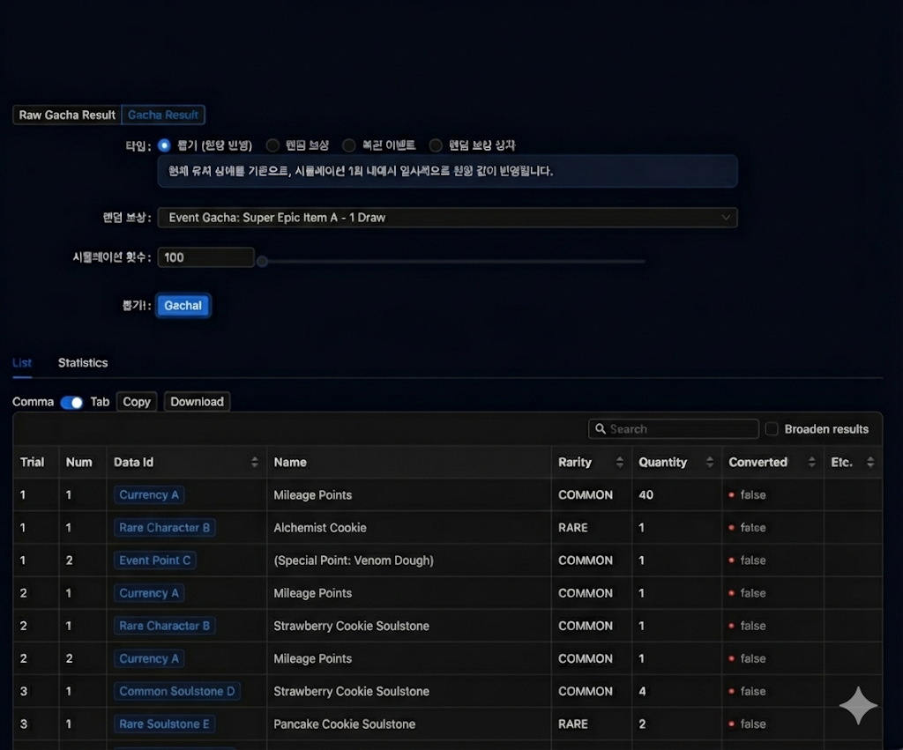

## Intro

I'm a developer working on a game development team. I want to share a story about a critical issue I faced and the systems I built to resolve it. It’s a story about random item systems, which are directly tied to user trust.

## The Incident - A Crack in Trust

The game I'm working on has a "gacha" system where users spend in-game currency to acquire random items. In such a system, the most crucial elements are to transparently disclose the probabilities to the user and to distribute items exactly according to those probabilities. Users set their expectations based on the provided rate table, and this becomes a measure of their trust in the service.

The incident happened out of the blue. A user reported:

> "I got an item from the gacha that wasn't even on the rate table."

At first, I couldn't believe it. It's a huge problem if an item on the rate table fails to appear, but the opposite scenario—an item _not_ on the list appearing—is a critical bug that shakes the very foundation of the system's credibility. If that item had been advertised as "only obtainable through real-money purchases," the sense of betrayal among users who had already bought that package would have been immense.

## Root Cause Analysis - An Unexpected Detour

Recognizing the severity of the problem, I immediately began to investigate the cause. My first suspicion, naturally, was a discrepancy between the logic that "displays the rate table" and the logic that "actually draws the item."

It goes without saying that the logic for `showRatesTable` and `drawGacha` must share the same data and functions. The entire process should use a common flow, branching only at the **final step** to either "display the table to the user" or "draw an item based on those rates."

My system was built strictly following this principle, so I was confident in its logical consistency. So, where did the problem come from? After checking the user's logs, I confirmed their report was true. An unintended item had indeed been awarded. I formed several hypotheses and traced the code.

1. **An Item Substitution System?** Our game has a system that replaces a duplicate item with something else if the user already owns it. However, this case would have left a clear log, such as "Item A was drawn, replaced with Item B." This wasn't it.
2. **The Hidden Detour: The "Pity System"**: Herein lay the root of the problem. My gacha system included a so-called **"pity system"** to guarantee a better reward for users who performed a certain number of draws. Normally, it references a standard item list called `pool1`, but users who hit the pity counter would receive a reward from a superior list called `pool2`.

The problem was that `pool2` contained an item that was not present in `pool1`. Because the pity system is **dynamic** and depends on a user's cumulative draw count, its possibilities were not fully reflected in the **static** rate table. From the user's perspective, an unexpected item that wasn't on the rate table had simply 'popped out' of nowhere.

## Test Random Systems

This incident forced me to think deeply about how to test systems that include random elements. Randomness, by its nature, is **non-deterministic**, which makes it notoriously difficult to automate tests for.

For example, consider the following code:

```scala
// A function to draw a random item
def drawGachaItem(): Item = {
  val items = List(Item("Sword"), Item("Shield"), Item("Potion"))
  val index = scala.util.Random.nextInt(items.length)
  items(index)
}

// This test is likely to fail because the result changes on each run.
val result = drawGachaItem()
assert(result.name == "Sword")
```

The classic solution is to make the test environment deterministic by fixing the random seed.

```scala
def drawGachaItemWithSeed(random: Random): Item = {
  val items = List(Item("Sword"), Item("Shield"), Item("Potion"))
  val index = random.nextInt(items.length)
  items(index)
}

// Using a fixed seed ensures the same result every time.
val fakeRandom = new Random(0)
val result = drawGachaItemWithSeed(fakeRandom)
assert(result.name == "Potion") // Now, this test will consistently pass or fail.
```

However, the problem I was facing—the item pool mismatch caused by the pity system—couldn't be solved simply by fixing a random seed. The goal wasn't to predict a single outcome, but to perform an **exhaustive check of all possible item types** that could be awarded.

## My Approaches

After much consideration, I implemented two powerful solutions to build a multi-layered verification system.

### Approach 1: Preemptive Blocking via Static Data Analysis

The first solution is a static analysis step that validates all gacha item pools during the game data build process. The logic is as follows:

1. Take the base item pool (`pool1`) for a gacha, and flatten it into a set of all possible items.
2. Take the item pools for special conditions like the pity system (`pool2`), and flatten them into sets as well.
3. **Check if `pool2` is a subset of `pool1`**.
4. If even a single item exists in `pool2` that is not in `pool1`, fail the data build and throw an error.

```scala
// This is pseudocode to explain the logic, not literal production code.
def validateGachaPools(gachaGroup: GachaGroup): Result[Unit] = {
  // 1. Get the set of items from the base pool (pool1) used for the rate table.
  val basePoolItems: Set[ItemId] = getBasePoolItems(gachaGroup.basePoolId)

  // 2. Get all item sets from special pools (pool2, pool3...).
  val specialPoolItemIds: List[PoolId] = gachaGroup.specialPoolIds
  val specialPoolItems: List[Set[ItemId]] = specialPoolItemIds.map(getSpecialPoolItems)

  // 3. Check if every special pool is a subset of the base pool.
  specialPoolItems.foreach { specialItems =>
    val unexpectedItems = specialItems -- basePoolItems
    if (unexpectedItems.nonEmpty) {
      // 4. If not, fail the build, specifying which items are problematic.
      return Failure(s"GachaGroup ${gachaGroup.id}: Special pool contains items not in base pool: $unexpectedItems")
    }
  }
  Success(())
}
```

With this validation logic, I could prevent any item not on the rate table from being included in the system in the first place. This approach completely solved the original problem: it provided a 100% guarantee that an item not on the rate table could never appear, even from a special pool.

#### The Limitations of Static Analysis

However, I soon realized that while this static check was crucial for data integrity, it had its own limitations. It could answer "_what_ can appear," but it couldn't answer several other critical questions:

- **Are the probabilities correct?** The analyzer confirms all items in `pool2` also exist in `pool1`, but it doesn't verify if their drop rates match the intended design. An item's probability could be 0.1% in the main pool but accidentally set to 10% in the pity pool.
- **How does dynamic, user-specific logic behave?** It cannot account for logic that depends on a player's state, like the "item substitution" feature for users who already own a specific item. The final reward can change based on a user's unique inventory.
- **What is the actual user experience?** The check provides no insight into the player's journey. It can't tell you the average cost to acquire a target item or if the overall experience _feels_ fair and rewarding.

To address these gaps, I needed a way to observe the system in action, which led me to my second approach.

### Approach 2: Dynamic Verification Using a Simulator

To catch complex cases that static analysis might miss and to predict the actual user experience, we can think a "simulator." A simulator offers tremendous advantages:

- **Statistical Verification**: By running tens of thousands of virtual draws, it provides a statistical analysis of the results, achieving an effect close to an exhaustive check.
- **Visualization and Communication**: A report like, "After 5,000 draws, these items appeared with this frequency," is easy for non-developer colleagues to understand, facilitating collaborative reviews of whether the design intent was met.
- **Complex State Replication**: It can simulate complex logic where draw results depend on a user's state (level, inventory, progress), providing much broader test coverage for various user.
- **User Experience Prediction**: Beyond just finding bugs, it helps quantitatively predict UX metrics like, "What is the average number of draws required to get a specific item?" This data is invaluable for balance tuning.

#### The N-Repetition Simulator



This is the most basic simulator. It runs a specific gacha `N` times and returns a list and count of all acquired items.

```scala
// Abstracted code for the N-repetition simulator logic
def runSimpleSimulation(gachaId: GachaId, count: Int): SimulationResult = {
  val singleTry = program.runGachaOnce(gachaId) // The logic for a single draw
  val results = singleTry.replicate(count)      // Replicate it N times
  return aggregateAndAnalyze(results)           // Aggregate and analyze the results
}
```

#### The Target Reward Acquisition Simulator


Taking it a step further, I decided to simulate the "end-to-end user journey." This tool creates `N` virtual users and measures how many draws it takes for each user to acquire a set of specified target items.

```scala
// Abstracted code for the target acquisition simulator logic
def runTargetSimulation(gachaId: GachaId, targetItems: Set[ItemId], userCount: Int): TargetSimulationResult = {
  // Run simulations in parallel for N virtual users
  val results = parallel_for_each(1 to userCount) { user_id =>
    // Each user keeps drawing until all target items are acquired
    simulateUntilTargetAcquired(gachaId, targetItems)
  }
  return aggregateAndAnalyze(results) // Aggregate results, like draws-per-user
}
```

#### Limitations of the Simulator Approach

However, the simulator is not a silver bullet and has its own set of trade-offs:

- **It's Statistical, Not Exhaustive:** A simulation provides strong statistical confidence, but it is not a formal proof. A bug with an extremely low probability (e.g., 1 in a million) might not appear in a simulation of 100,000 runs. It reduces risk but doesn't eliminate it with absolute certainty.
- **It Can Be Slow and Resource-Intensive:** Running millions of complex simulations can take significant time and computational power, making it less suitable for running on every single code commit.
- **The Simulator Itself Can Have Bugs:** The simulation environment must perfectly mirror the production logic. Any discrepancy means the simulation could produce misleading results, creating a false sense of security.

### Bringing It Together

Ultimately, these two approaches are not mutually exclusive; they are complementary. The static analyzer provides a fast, deterministic guarantee on data integrity, while the simulator provides deep, statistical insights into dynamic behavior and probabilities. Together, they form a much more robust system for ensuring fairness and protecting user trust.

## Conclusion

Ensuring the integrity of a "gacha" system is more than just a technical challenge—it is the bedrock of player trust. As this incident showed, even a well-intentioned "pity system" can create hidden detours that lead to critical discrepancies between the advertised rates and actual rewards.

By adopting a multi-layered defense strategy, I moved from "hoping the code is correct" to "proving the data is valid":

- **Static Analysis:** Acts as a gatekeeper during the build process, ensuring that no unintended items ever enter the gacha logic.
- **Dynamic Simulation:** Provides statistical confidence and predicts the end-to-end user journey, catching edge cases that static rules might miss.
