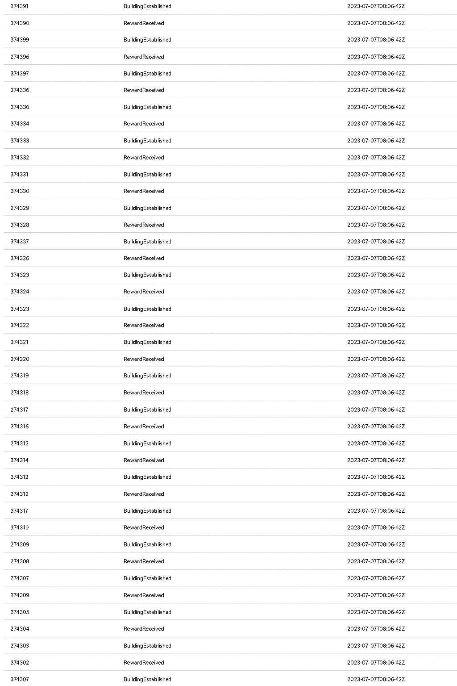

## Intro

I currently work with an **Event Sourcing (ES)** architecture. One of the most interesting parts of ES is its database usage patterns. I always keep a close eye on how client requests create load on our database. In this post, I want to share an interesting DB load problem I faced and how I solved it. First, let's quickly go over what Event Sourcing is.

## What is Event Sourcing?

Event Sourcing is an architectural pattern where all changes to an application's state are stored as a sequence of events. Instead of just saving the _current_ state (the traditional way), ES carefully records _every_ event that led to that state, in the order they happened.

Typically, you only need two database tables to store an entity's state:

- **Journal:** This table records all events in the order they happen, just like a detailed accounting ledger.

```sql
CREATE TABLE IF NOT EXISTS journals (
  -- ID of the entity the event belongs to (e.g., user_id, guild_id)
  persistence_id VARCHAR(255) NOT NULL,
  -- Event number (starts from 1)
  sequence_number INT8 NOT NULL,
  -- Event type (determines which object to deserialize into)
  manifest VARCHAR(255) NOT NULL,
  -- The event binary, serialized (e.g., protobuf)
  journal BYTEA NOT NULL,
  -- When the event was created
  created_at TIMESTAMP NOT NULL,

  PRIMARY KEY(persistence_id, sequence_number)
);
```

- **Snapshot:** This table stores the application state at a specific point in time. Replaying all events from the journal to get the current state can be slow, so we save snapshots regularly to speed up recovery.

```sql
CREATE TABLE IF NOT EXISTS snapshots (
  -- ID of the entity (e.g., user_id, guild_id)
  persistence_id VARCHAR(255) NOT NULL,
  -- The last event number included in this snapshot. 
  -- (e.g., 100 means this state reflects events up to #100)
  sequence_number INT8 NOT NULL,
  -- Snapshot type (for deserialization)
  manifest VARCHAR(255) NOT NULL,
  -- The snapshot binary, serialized (e.g., protobuf)
  snapshot BYTEA NOT NULL,
  -- When the snapshot was created
  created_at TIMESTAMP NOT NULL,

  PRIMARY KEY(persistence_id, sequence_number)
);
```

As we develop new features, we often define new event types. However, **we don't need to change the `journals` or `snapshots` DB schema** each time. This is a huge benefit of Event Sourcing: the database usage pattern is very simple, so we don't have to worry about schema migrations for new features.

"Update" requests work by publishing new events. "Get" requests work by loading the latest snapshot and then replaying any new events from the journal on top of it.

Let's use a kingdom-building game as an example. When a user requests to 'establish a building,' two events are generated:

- `BuildingEstablished`
- `RewardReceived`

The game server gets the final user state by loading a snapshot and replaying these two new events.

## Repeated Journaling Problem

The `establishBuilding` feature already existed. It included various checks, like building location validation and user level checks, etc.

Then, we got a new requirement: **a feature to build multiple buildings at once.** Instead of clicking the button 100 times to build 100 buildings, the user could just click a 'Build All' button once. This would be much more convenient.

How should we implement this? The existing `establishBuilding` function was stable. It had been through code reviews and QA, and was proven in our live environment. To reuse this stable logic, we considered calling it repeatedly, like `establishBuilding.replicateA(n)`.

We actually implemented it this way, and it worked fine on live. However, our metrics showed something suspicious. You've probably already guessed the problem. We were tracking a metric called `lifted-events-count`, which counts the events generated by a single RPC request.

```scala
// Part of the event persistence logic (conceptual code)
val eventsToPersist: List[Event] = ...
// add tracing
tracing.setAttribute("lifted-events-count", eventsToPersist.length)
// persists to DB
persistentEntityRepository.addEvents(eventsToPersist)
```

And we discovered that an excessive number of events were being saved in a single transaction.

```sql
// Query in Datadog
env:prod-live-* and @lifted-events-count:>=80
```

If a request was caught by this query, it meant a single RPC request was creating 80 or more events. We confirmed the `EstablishBuilding` RPC was triggering this and checked the DB state at that timestamp.



I found **a huge number of repeated `BuildingEstablished` and `RewardReceived` pairs with same timestamp.**

## Two Approaches for DB Journaling Optimization

To fix this, I needed to add some journaling optimization logic. The question was, _where_ should this logic live?

1. One option is in a **post-process layer**, which looks at all events after they are generated and merges them.
2. The other is in the **domain logic layer**, which creates optimized (merged) events from the start.

Let's look at both.

### Approach 1: Event Aggregation in a Post-Processing Layer

The first approach is to create an optimization process in a "post-process" layer. This layer can see all the events emitted by the domain logic. It looks for specific patterns and merges them.

In our example (building 100 buildings), this layer would see 200 events (100 pairs of `BuildingEstablished` -> `RewardReceived`). It would then optimize them into just two aggregated events: `BuildingsEstablished(buildings)` and `RewardsReceived(rewards)`.

To do this, we'd need an `EventOptimizer` that recognizes the `BuildingEstablished` -> `RewardReceived` pattern and converts it.

```scala
/**
 * Concept: Pattern-based Event Aggregator
 * Merges consecutive (BuildingEstablished -> RewardReceived) pairs 
 * into aggregated events (BuildingsEstablished, RewardsReceived).
 */
def optimize(events: List[Event]): List[Event] = {
  // Tail-recursive helper to maintain state while traversing
  def loop(remaining: List[Event], buildings: List[Building], rewards: List[Reward]): List[Event] = 
    (remaining, buildings, rewards) match {

      // Case 1: Matching the Pattern (Building -> Reward)
      case (BuildingEstablished(b) :: RewardReceived(r) :: tail, bs, rs) =>
        loop(tail, bs :+ b, rs :+ r)

      // Case 2: Pattern ends or non-matching event found
      case (other :: tail, bs, rs) =>
        flush(bs, rs) ++ (other :: loop(tail, Nil, Nil))

      // Case 3: Reached the end of the list
      case (Nil, bs, rs) => 
        flush(bs, rs)
    }

  // Helper to convert collected items into aggregated events
  def flush(bs: List[Building], rs: List[Reward]): List[Event] = 
    List(Option.when(bs.nonEmpty)(BuildingsEstablished(bs)), 
         Option.when(rs.nonEmpty)(RewardsReceived(rs))).flatten

  loop(events, Nil, Nil)
}
```

#### Pros

The big advantage here is that the domain logic stays clean. The domain can still express the business logic as `establishBuilding.replicateA(n)`. Developers can focus on the core domain logic without worrying about optimization details.

#### Cons

However, there are serious downsides. If a new feature is added to the logic layer that breaks this pattern, the post-process optimizer might break.

For example, imagine a new requirement where building costs a resource (`Paid`). The journal pattern would become: `BuildingEstablished` -> `Paid` -> `RewardReceived` -> `BuildingEstablished` -> `Paid` -> `RewardReceived` -> ... The old optimizer, which was designed to find `BuildingEstablished` -> `RewardReceived` pairs, would stop working.

Another risk is that post-processing can **damage the integrity of the events**, which is a core strength of Event Sourcing. Event optimization can lead to the loss of the original result.

For example, let's say we aggregate the `BuildingEstablished` -> `Paid` -> `RewardReceived` -> ... pattern into three aggregated events: `BuildingsEstablished`, `Paids`, and `RewardsReceived`. If the original `Paid` event decreased `itemId1` by 1, the aggregated `Paids` event might decrease `itemId1` by `n` all at once.

The result of **(pay -1, get reward +1) repeated _n_ times** can be different from the result of **(pay -_n_, get reward +_n_) done once**. The second case might fail if the item count drops below zero. Or, if the item has a `.max(0)` control to prevent it from going negative, it wouldn't fail but the final state could be different. In other words, event aggregation can subtly change the flow of state changes and cause unexpected side effects.

Because of this, the post-process approach is more suitable for **simple, repetitive patterns of a _single_ event type**, (e.g., `RewardReceived` -> `RewardReceived` -> ...). It's generally **not recommended** for complex patterns involving multiple event types that are deeply connected to changing domain logic.

### Approach 2: Emitting Merged Events from the Domain Logic Layer ✅

The best solution for our specific problem, and the one we ultimately chose, was to **emit aggregated events directly from the domain logic layer.** This optimizes events at their source. We define and emit new aggregated events like `BuildingsEstablished` and `RewardsReceived` from within the domain logic itself.

Back to our game example: for 100 simultaneous building constructions, instead of emitting 100 pairs of `BuildingEstablished` and `RewardReceived`, we emit just two aggregated events: a single `BuildingsEstablished` event containing all built buildings, and a single `RewardsReceived` event containing all earned rewards.

```scala
// Emits 2 * n events (BuildingEstablished, RewardReceived)
def establishBuilding(building: Building): ZPure[Event, GameState, GameState, Any, Failure, Unit] =
  for {
    _ <- ZPure.validate(checkLocation(building))
    _ <- ZPure.log(BuildingEstablished(building)) // Single log
    s <- ZPure.get[GameState]
    _ <- ZPure.log(RewardReceived(getRewards(s, building))) // Single log
  } yield ()

def buildAll(buildings: List[Building]) = ZPure.foreach(buildings)(establishBuilding)
```

⬇️

```scala
// Emits exactly 2 aggregated events
def establishBuildings(buildings: List[Building]): ZPure[Event, GameState, GameState, Any, Failure, Unit] =
  for {
    _ <- ZPure.validate(checkAllLocations(buildings))

    // Process all logic first without logging
    results <- ZPure.traverse(buildings) { b =>
      ZPure.get[GameState].map(s => (b, getRewards(s, b)))
    }

    // Flush as aggregated data
    _ <- ZPure.log(BuildingsEstablished(results.map(_._1)))
    _ <- ZPure.log(RewardsReceived(results.flatMap(_._2)))
  } yield ()
```

#### Pros

This approach drastically reduces the DB journal load by emitting only two events (`BuildingsEstablished(...)` and `RewardsReceived(...)`) instead of hundreds. And the likelihood of the domain logic being damaged by the optimizer is low. This is because the optimizer itself is part of the domain logic, so when new features are introduced, it is unlikely that one will be considered without the other.

#### Cons

However, this method makes the domain logic a bit messier and increases implementation difficulty. It must be written carefully to ensure the state change is logically identical to calling `buildings.traverse(establishBuilding)` for all scenarios. There's definitely room for error, and using `buildings.traverse(establishBuilding)` feels cleaner and more intuitive. But for the sake of performance, I often find this level of added complexity in the domain logic acceptable.

## Why Event Sourcing Makes This Optimization Possible

Before we finish, I want to revisit _why_ Event Sourcing makes these kinds of optimizations possible. It's because its DB usage pattern is so simple.

**First, the schema is simple.** In a traditional SQL (relational database) approach, we would need a `buildings` table to store building info and a `rewards` table (or update a `user_items` table). To optimize a "build multiple" feature, we'd have to think about "bulk inserts" (`INSERT INTO buildings ... VALUES (...), (...), ...`) or "bulk updates" for the `user_items` table. This means the **application logic is tightly coupled with the DB schema.** In Event Sourcing, the schema is just the `journals` table, so we can focus only on the _logical_ optimization of "combining events" at the application level.

**Second, emitting events is separate from saving (persisting) them.** In ES, a DB access doesn't happen the instant an event is "emitted." The event is just an "Effect" that has been declared. In our project, the act of _emitting_ an event and the act of _persisting_ it to the database are naturally separated. This lets us delay the actual process of saving the event to the DB, and this "lazy space" gives us room to consider various optimization strategies easily. Because these two actions are separate, we get the flexibility to collect and optimize events _before_ they are finally written to the DB.

## Conclusion

The first **post-process approach** offers the benefit of keeping the domain logic clean. It allows developers to avoid constantly worrying about the number of events emitted from complex domain logic. This method is effective for simple, repetitive patterns, like `RewardReceived` appearing in many parts of the logic. However, you must remember that it **carries the risk of damaging the integrity of the event history.**

In contrast, the second approach—**emitting merged events from the logic layer**—optimizes at the source. It provides a more fundamental and stable solution. The trade-off is that the domain logic becomes more complex because it has to include event aggregation logic.

In our project, we see both approaches as valid and apply them appropriately based on their pros and cons.
