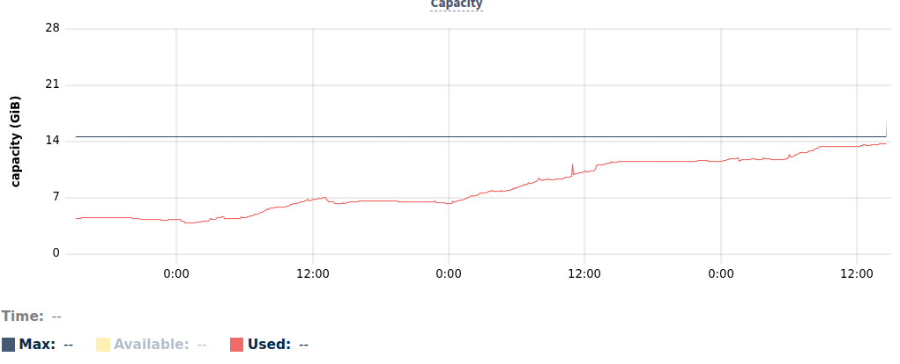
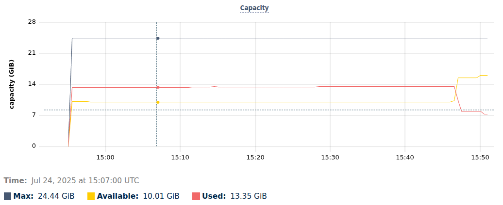

## Intro

I recently ran into an Out-of-Memory (OOM) error with CockroachDB (CRDB) in our development environment. I want to share how I found the issue and the steps I took to fix it. I'll explain what caused this OOM problem and how I used system tables and internal queries to find clues. I'll also show how I finally solved the problem.

## The Mysterious OOM Killer

Our QA team reported that they couldn't connect to the server. I quickly checked the server states and found the logs of our CRDB pod. The pod had crashed due to an Out-of-Memory (OOM) error. At first, I was confused. It seemed strange for a database to fail because of a lack of memory rather than disk space. Disk space also reached its limit in the end, because failures of the `DELETE` queries had been adding up.



To find the root cause, I decided to look into CRDB's internal system tables, specifically `crdb_internal.jobs`. I ran this query to find jobs that had not succeeded:

```sql
SELECT
    job_id,
    job_type,
    description,
    status,
    error,
    created
FROM
    crdb_internal.jobs
WHERE
    status <> 'succeeded'
ORDER BY
    created ASC;
```

The `error` column contained the exact clue I was looking for.

```text
error during row deletion: ttl delete game_db.public.snapshot_histories@"snapshot_histories_pkey": ... root: memory budget exceeded: 2099200 bytes requested, 267192320 currently allocated, 268435456 bytes in budget
```

The message was clear: "memory budget exceeded." The TTL delete job was trying to use more memory than it was allowed. This message gave me some important hints. I wondered how big a single row in the `snapshot_histories` table was. To get a rough idea, I ran this query:

```sql
SELECT
  sum(total_approximate_size) AS grand_total_size
FROM (
  SELECT
    (
      octet_length(snapshot_id) +
      octet_length(user_state_bytes)
    ) AS total_approximate_size
  FROM
    snapshot_histories
  WHERE
    snapshot_id LIKE 'ABCDE1234%'
) AS derived_table;
```

The result was about **2MB**, mostly from the `user_state_bytes` column. The 2,099,200 bytes from the error log is also about 2MB. This suggested that the error was happening while processing a **single row**.

Then I remembered the TTL job I had set up on the `snapshot_histories` table. What did that job do? And how could it be using so much memory?

## CRDB Row-Level TTL

In our project's "dev" environment, we have a feature called `TakeSnapshot` that makes QA testing easier. It saves a snapshot of a user's state (`UserState`). This allows us to roll back data to an earlier point in time when needed. Because this function is called often, the `snapshot_histories` table grows very quickly.

We didn't need to store this data forever. So I set up a TTL (Time-to-Live) feature to automatically clean up old records. CRDB makes this easy to set up. You just add a simple `WITH` clause when you create the table.

```sql
-- for snapshot_histories
SET DATABASE = game_db;

CREATE TABLE IF NOT EXISTS snapshot_histories (
    snapshot_id VARCHAR(255) NOT NULL PRIMARY KEY, -- A combination of user_id + timestamp
    user_state_bytes BYTEA NOT NULL, -- The large user state data
    expires_at TIMESTAMPTZ NOT NULL
) WITH (
    ttl_expiration_expression = 'expires_at',
    ttl_job_cron = '@hourly' -- Delete expired data every hour
);

-- Index for the TTL cleanup job
CREATE INDEX ON snapshot_histories (expires_at);
```

This setup automatically deletes expired data every hour based on the `expires_at` column. This table was only used in the dev environment, so I applied the setup without thinking much about it. Indexing a timestamp column is generally not recommended. However, the official CRDB documentation ([https://www.cockroachlabs.com/blog/row-level-ttl-cockroachdb-mmorpgs/#1.-Prioritize-Indexing-for-Efficient-Deletions](https://www.cockroachlabs.com/blog/row-level-ttl-cockroachdb-mmorpgs/#1.-Prioritize-Indexing-for-Efficient-Deletions)) recommends it for TTL to make sure deletions are efficient. I did not know that this convenient feature had a hidden problem.

## Internal Analysis

You can find the actual internal query that the TTL job runs by checking CRDB's logs and documentation. I found it in the `description` column when I queried the `crdb_internal.jobs` table.

```sql
-- Internal query for the TTL Job (masked and simplified)
-- ttl for game_db.public.snapshot_histories

-- 1. for each span, iterate to find rows:
SELECT snapshot_id
FROM game_db.public.snapshot_histories
AS OF SYSTEM TIME INTERVAL '-30 seconds'
WHERE ((expires_at) <= $1)
  AND ((snapshot_id >= $3))
  AND ((snapshot_id <= $2))
ORDER BY snapshot_id ASC
LIMIT 500;

-- 2. then delete with:
DELETE
FROM game_db.public.snapshot_histories
WHERE ((expires_at) <= $1)
  AND (snapshot_id) IN (($2));
```

This query showed a two-step process:

1. **SELECT phase**: First, it selects up to 500 primary keys (`snapshot_id`) of rows to be deleted, using `LIMIT 500`. This matches the `ttl_select_batch_size` setting, which is 500 by default.
2. **DELETE phase**: Then, it takes those 500 keys and deletes the actual rows in smaller groups using an `IN (...)` clause. This part is controlled by `ttl_delete_batch_size`, which is 100 by default. During this step, all the data for those 100 rows is loaded into memory.

In other words, every time the TTL job ran, CRDB was saying: "Find 500 expired snapshot IDs, then delete them in 5 batches of 100. Okay, let's start the first delete transaction for 100 rows!"

This **100-row delete batch** was the main cause of the problem. `TakeSnapshot` was called so often that thousands of rows could expire in a given hour. It made sense that the TTL job was trying to load 100 of these huge 2MB rows into memory for a single delete transaction.

> 100 rows \* 2MB per row ≈ 200MB

One such transaction needs nearly 200MB. That is about 75% of the node's memory budget (268,435,456 bytes, or about 268MB). The error log shows that 267,192,320 bytes were already allocated. There was not enough room for one more 2MB row. I had confirmed that the TTL job was exceeding its memory budget. But one basic question remained: "Why does a simple delete operation need so much memory?" Shouldn't it just remove the data directly from the disk?

## Why Does a Delete Operation Use Memory?

My first guess was simply "because of MVCC." After I looked deeper, that turned out to be only half the answer. MVCC explains why the **disk** filled up, but not why the **memory** ran out. The two problems had different causes, so it's worth looking at them separately.

### Deletion Is a 'Write', Not an 'Erase' (The Tombstone Mechanism)

In CockroachDB, a `DELETE` does not physically remove data right away. Internally, data is stored as _key + timestamp → value_. A delete writes a new version of the key called a **tombstone**. It says "this key is deleted as of this timestamp."

```text
snapshot_histories/<id> @ 10:00 → { user_state_bytes (~2MB), expires_at }
snapshot_histories/<id> @ 11:00 → (deleted)   ← tombstone written by DELETE
```

A read at 11:05 picks the 11:00 version and sees nothing. A read with `AS OF SYSTEM TIME '10:50'` picks the 10:00 version and still sees the row. This is what makes time-travel queries possible. It also lets concurrent transactions each see a consistent view of the data.

But notice how small a tombstone is. It is just a key, a timestamp, and a "deleted" marker. Its size doesn't depend on how many columns the row has or how large they are. **Writing 100 tombstones can't explain 200MB of memory.**

### The Memory Goes to _Reading_ the Rows, Not Writing Tombstones

Does CockroachDB always read a row before deleting it? Not necessarily. I reproduced the setup locally (CockroachDB v24.3.15, 20 rows of ~2MB each). I compared three versions of the table with `EXPLAIN ANALYZE`, deleting all 20 rows by primary key:

| Table | Plan | KV bytes read | Max memory |
| --- | --- | --- | --- |
| A. Same as ours: one column family + index on `expires_at` | `scan` → `delete` | 38 MiB | 38 MiB |
| B. One column family, no secondary index | `delete range` | (no scan) | 10 KiB |
| C. Two column families + index on `expires_at` | `scan` → `delete` | 501 B | 30 KiB |

Two things are clear:

- **The secondary index is what forces the read.** Without it (B), a primary-key delete becomes a `delete range`. This simply writes tombstones without reading any row data. With the index on `expires_at` (A), deleting a row also means deleting its index entry. That entry's key contains the row's `expires_at` value. So the plan has to scan `(snapshot_id, expires_at)` first, even though the `WHERE` clause only uses the primary key.
- **The single column family decides how much is read.** CockroachDB stores each column family of a row as a single KV pair. Our table didn't declare any families. So all non-primary-key columns, including the ~2MB `user_state_bytes`, were stored in one value. The plan only needed `expires_at`, but reading it meant reading the whole 2MB value (A: 38 MiB for 20 rows). With `user_state_bytes` in its own family (C), the same delete read only 501 bytes.

We can scale A up to the TTL job's default batch of 100 rows. This gives roughly 100 × 2MB ≈ 200MB in one transaction. The SQL memory budget is 268,435,456 bytes (256MiB). The `2099200 bytes requested` in the error matches the size of one row. (I measured plain primary-key deletes. The TTL job's own DELETE may add extra conditions.)

### Where MVCC Does Come In: The Disk (The Disk GC)

The physical removal happens much later, through Garbage Collection (GC) and compaction. The GC in languages like Java frees memory. In contrast, CockroachDB's storage GC frees **disk space**. Old versions and tombstones stay on disk until the GC TTL (25 hours by default) passes. Only then does background compaction remove them. Until then, deleted data keeps taking up disk space, and later scans still have to step over it.

So the two symptoms of this incident had two different causes:

| Symptom | Cause | Fix |
| --- | --- | --- |
| Memory (OOM, `memory budget exceeded`) | Reading the rows to delete them: index maintenance, plus one column family pulling in the 2MB value | Smaller delete batches (100 → 50) |
| Disk pressure | MVCC: deleted data stays on disk until the GC TTL passes | Larger PVC (15Gi → 25Gi), shorter GC TTL in dev (25h → 600s) |

The experiment above points to one more fix I would consider. I would move large, rarely updated columns into their own column family with a `FAMILY` clause (table C). Then reading `expires_at` would not also read `user_state_bytes`. The CockroachDB docs recommend this for large columns that are rarely updated. In my local test, it cut the bytes read from 38 MiB to 501 B. But I would still check it against the real workload before relying on it.

```sql
CREATE TABLE snapshot_histories (
    snapshot_id      VARCHAR(255) NOT NULL PRIMARY KEY,
    user_state_bytes BYTEA NOT NULL,
    expires_at       TIMESTAMPTZ NOT NULL,
    FAMILY meta  (snapshot_id, expires_at),
    FAMILY blobs (user_state_bytes)
) WITH (ttl_expiration_expression = 'expires_at', ...);
```

## The Solutions

### Initial Action

First, we quickly expanded the PVC (storage) from 15Gi to 25Gi.

```bash
kubectl patch pvc <PVC_NAME> \
  -p '{"spec":{"resources":{"requests":{"storage":"25Gi"}}}}'
```

Then, to quickly reduce disk usage, we adjusted the GC TTL, which is 25 hours by default.

The 25-hour GC TTL can be configured using:

```sql
alter table snapshot_histories configure zone using gc.ttlseconds = 600;
```

We applied this change to lower disk storage usage as quickly as possible. **I must stress again that this was possible because the issue happened in a development environment, not a production environment. This allowed me to take more aggressive measures.**



### Addressing the Root Cause

Once I understood the cause, the solution was simple. CRDB provides the `ttl_select_batch_size` and `ttl_delete_batch_size` options to control this behavior.

- `ttl_select_batch_size`: The number of rows to `SELECT` for deletion in the initial query.
- `ttl_delete_batch_size`: The size of each batch for the actual `DELETE` transaction.

I decided to make these values much more conservative. This reduces the amount of data being processed at one time.

```sql
-- Alter the snapshot_histories table settings
ALTER TABLE snapshot_histories SET (
    ttl_select_batch_size = 250, -- default was 500
    ttl_delete_batch_size = 50 -- default was 100
);
```

With this change, the TTL job now works like this:

1. It selects only **250** candidate IDs to delete (`ttl_select_batch_size`).
2. It runs the `DELETE` operation in 5 transactions, with **50 rows** in each one (`ttl_delete_batch_size`).

Now, a single `DELETE` transaction loaded far less data into memory.

> 50 rows \* 2MB per row = 100MB

After a transaction is committed, its resources are freed. This prevents memory from building up and overloading the node. After I applied this change, the OOM errors disappeared completely. Our CRDB pods also became stable again.

## Conclusion

CRDB's row-level TTL is a powerful and convenient feature. But this experience taught me a lesson about automated tools. Using them without understanding how they work inside can lead to unexpected problems. Here are my main lessons from this incident:

- **TTL is a batch job that may use a lot of memory.** A cron setting like `@hourly` defines a batch process that runs repeatedly. Most importantly, I learned that a delete has a cost. Writing the tombstone itself is cheap. But with a secondary index on `expires_at`, deleting a row means reading it first. All columns were also in a single column family, so every row we deleted loaded its 2MB `user_state_bytes` into memory.
- **Memory and disk had different causes.** It was tempting to blame everything on MVCC, but MVCC only explained the disk side. Deleted data and old versions stay on disk until the GC TTL passes. The memory side came from reading the rows to delete them. Separating the two made it clear which fix addressed which symptom. Smaller batches fixed memory. A larger PVC and a shorter GC TTL fixed disk.
- **You must set the size of batch operations, even deletes, based on row size.** The default `ttl_delete_batch_size` of 100 meant reading 100 of those large rows in a single transaction. Before I apply a TTL policy, I now check two things. First, I check whether **`(row size) * (ttl_delete_batch_size)`** fits in the node's memory budget. Second, I check whether large, rarely updated columns belong in their own column family.
- **Internal system tables (`crdb_internal.jobs`) are extremely useful for troubleshooting.** When background jobs like TTL fail, the error logs in this table give the most direct clues about the cause and behavior. I now have a habit of checking this table. It has become an extremely valuable part of my debugging process.

This experience was a strong reminder. Before you let an automated feature take over, it is very valuable to pause and ask, "What is the real cost of this operation, especially the memory cost?"
